<p align="center">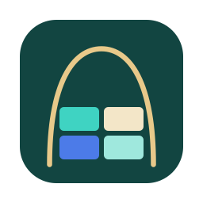</p>

# Bower

A window and workspace manager for macOS. Give each project a named layout and switch your whole desk, across every display, with ⌥1–9. There's no Spaces animation: windows from other layouts move out of the way and the layout you picked comes back where you left it.

It's native Swift with no dependencies, no account and no telemetry. It needs only the Accessibility permission, and SIP stays on. Screen Recording is optional: with it, the overview shows real window contents instead of each app's colour and icon. It checks GitHub for updates only if you turn that on.

<p align="center">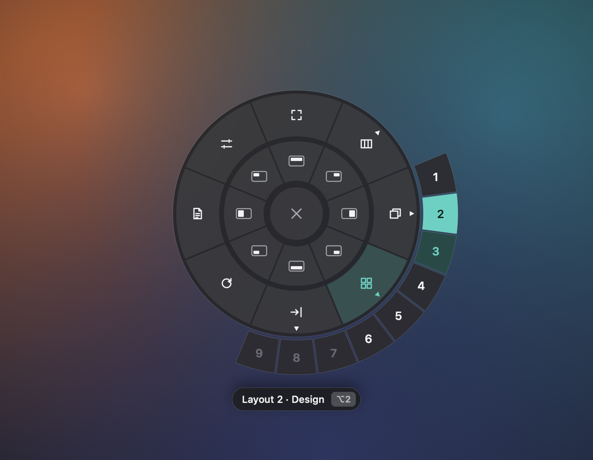</p>

## What it does

The UI follows the design canvas in [docs/design/](docs/design/); the plan is in [docs/DESIGN.md](docs/DESIGN.md).

- **9 named layouts** across every display: switch instantly, send a window to another layout, route apps to layouts so their new windows land there. Browser profiles route on their own: with an Edge or Chrome window of a profile in front, Bower's menu › the app › New windows open in routes just that profile.
- **Window Modes per display, per layout:**
  - **Native**: windows where you put them, with snapping.
  - **Bento Box**: auto-tiled; it retiles the moment a window opens or closes.
  - **Tabs**: windows from any app share a pane under a tab strip. Drag a tab to the pane's right edge to split it into two groups, or onto the other strip to move it. ⌃Tab cycles tabs in the focused group. Hold a file or link dragged from another app over a tab and that tab opens, so you can drop it inside.
  - **Dock**: windows sit side by side and never overlap. Drag a title bar to another window's edge to dock it there, or onto its middle to make a tab group. Drag the gaps to resize. The green button floats or docks a window; double-clicking a title bar shows it on its own.
- **Overview and Expand** (⌃⌥O, or pinch in): every window on every display, with your layouts along the top. Click one to go to it, ⌥-drag to rearrange, or drag a rectangle to expand it. In Dock mode, ⌃⌥= (or ⌥-pinch out) expands part of the layout to fill the screen, and ⌃⌥- goes back a level; ⌃⌥[ and ⌃⌥] go back and forward.
- **Saved views**: ⌃⌥⇧1–9 saves what you're looking at, ⌃⌥1–9 brings it back.
- **Gestures**: swipe with three or four fingers to move between layouts (Bower takes the swipe from macOS so both don't happen; hold fn for macOS's own), and optionally show Bower's overview instead of Mission Control.
- **Snapping** with a live preview: halves, quarters, thirds, two thirds, maximize.
- **Moving and sizing from the keyboard**: ⌃⌥⇧ and an arrow swaps a window with its neighbour, ⌃⌥W / ⌃⌥⇧W step its width through ½, ⅔, 90% and full, ⌃⌥C centres it, ⌃⌥B puts windows back after an app moved them, and ⌃⌥M sends one to the other display. Focus (⌃⌥⌘ and an arrow) carries on to the next display at the edge, and H J K L work as arrows with the focus and move keys.
- **Focus ring**: an optional line or soft glow around the window you're typing in (Settings › Appearance), where Bower's own windows can also be Light, Dark or Automatic.
- **Keep space free** along any screen edge for a widget bar (Settings › Dock); browser extension popups and other small panels are left where the app puts them.
- **Snap Wheel** (middle-click or ⌃⌥Space). Its outer ring is yours to arrange in Settings › Snap Wheel, with extra actions: Center, Almost Maximize, Next Display, Restore, Minimize, Hide Others, and the presets Split, Four Corners and Focus + Stack.
- **Layouts Bar** (⌥↑): every layout and its windows; drag a window onto a layout.
- **Workspaces**: save every layout, mode and window position under a name and load it later.
- **Continuity**: when an app quits and comes back (or the Mac restarts), its windows return to their layouts and places. A display that disconnects keeps its windows on the Offline shelf until it's back.
- **AI Recipes**: describe your desk in Markdown and let a model plan it: Ollama or LM Studio on your Mac, or Claude or OpenAI with your own API key.
- **Shortcuts**: every one can be rebound in Settings › Shortcuts, with an ISO keyboard preset and conflict warnings.
- **`bower://` links**: `bower://layout/3`, `bower://everything`, `bower://mode/dock` and more, for Shortcuts, Raycast or scripts.
- **Mac setup** at the top of Settings › General lists anything stopping a feature, with a button to the right switch.
- **Gets out of macOS's way**: one button in Settings › General turns off edge tiling, click-wallpaper-to-show-desktop and Stage Manager, and another turns them back on.

## Screenshots

<p align="center">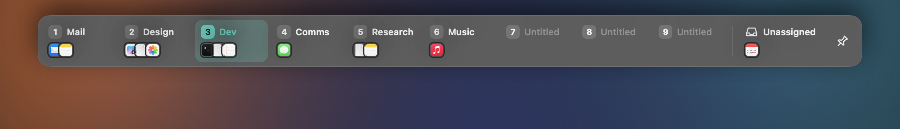</p>

| | |
| --- | --- |
| 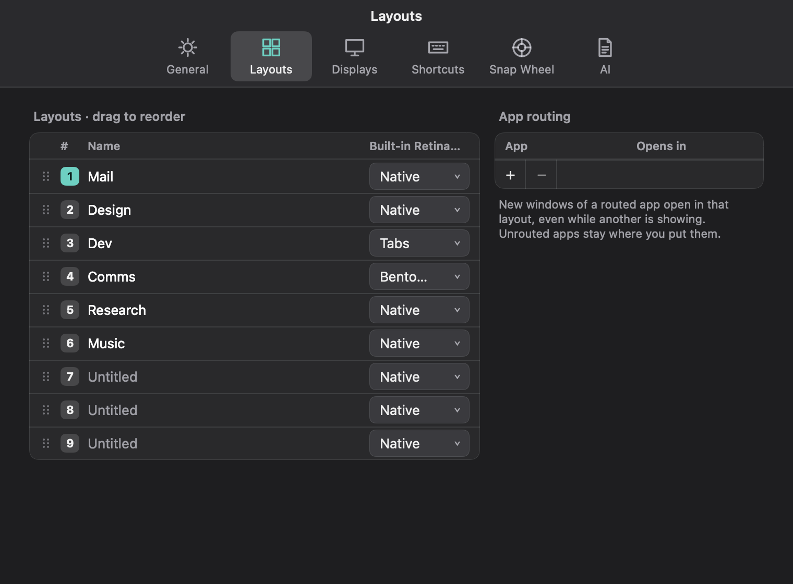 | 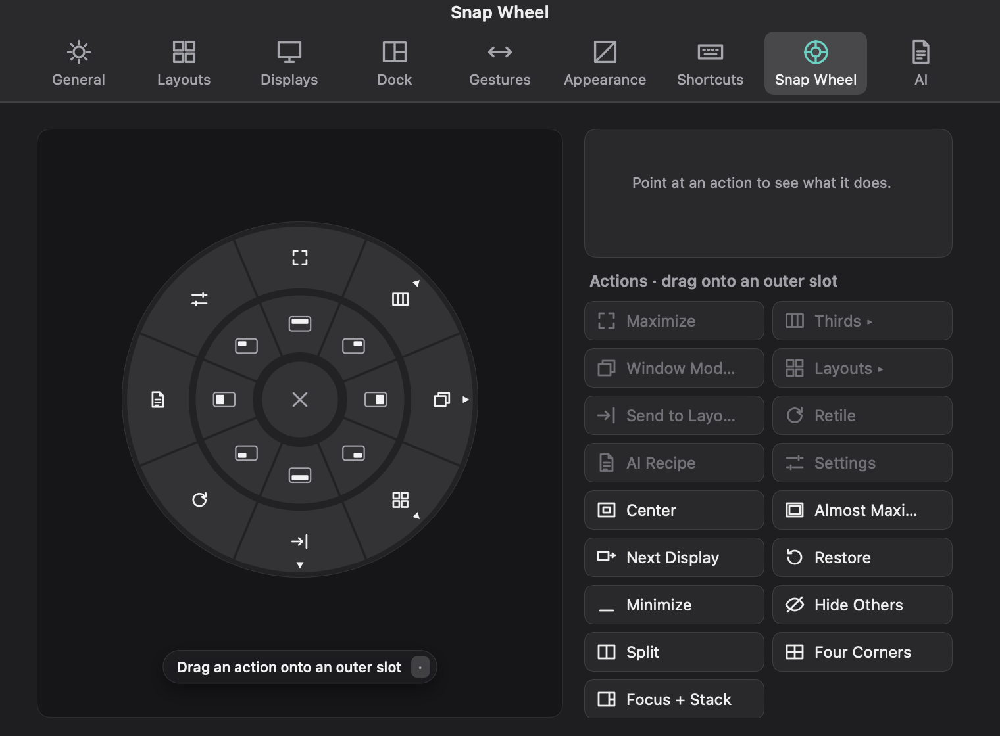 |
| 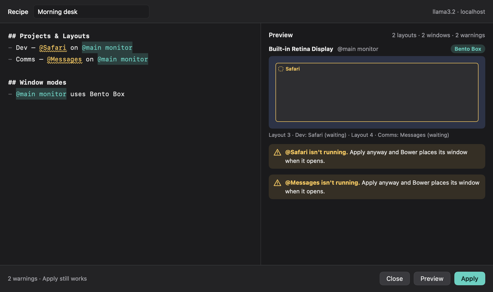 | 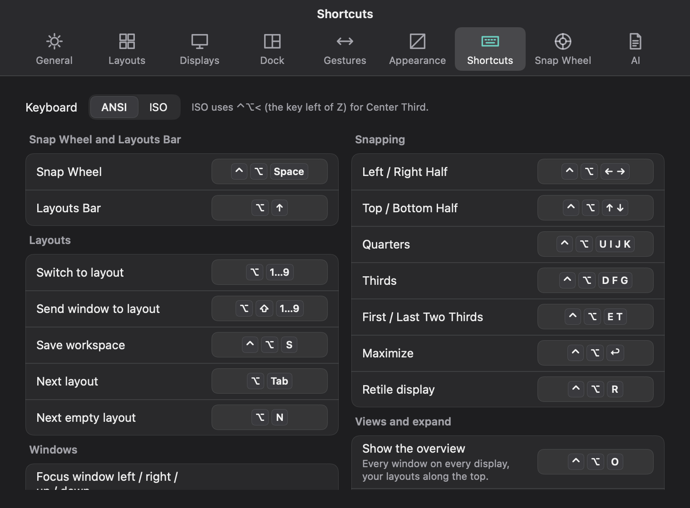 |
| 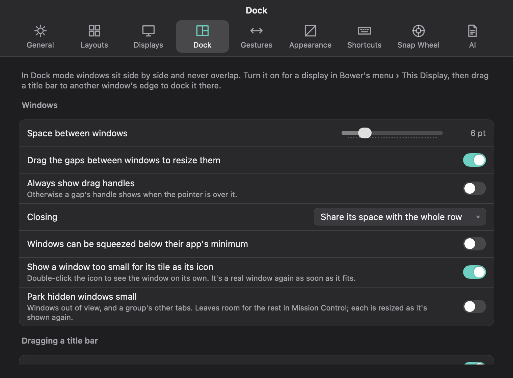 | 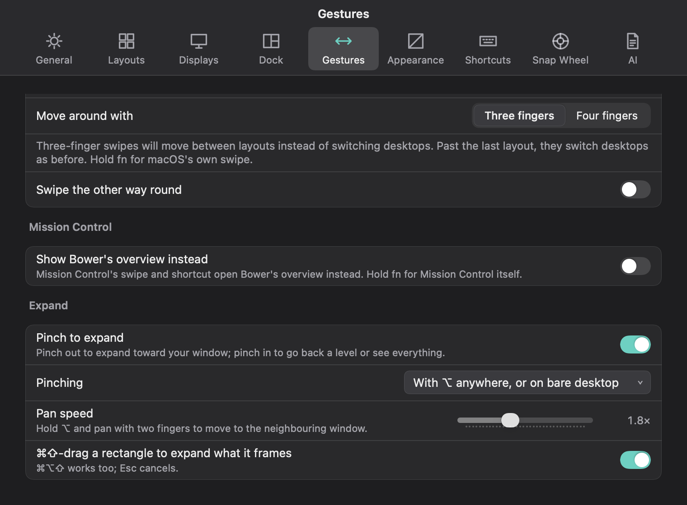 |
| 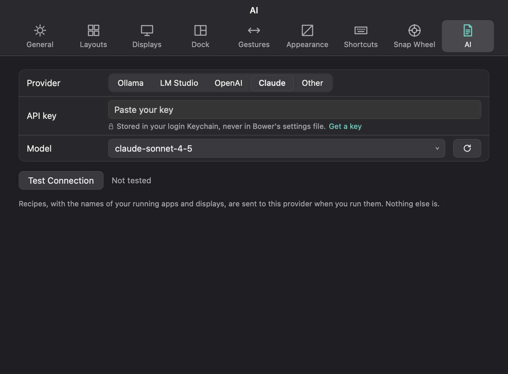 | 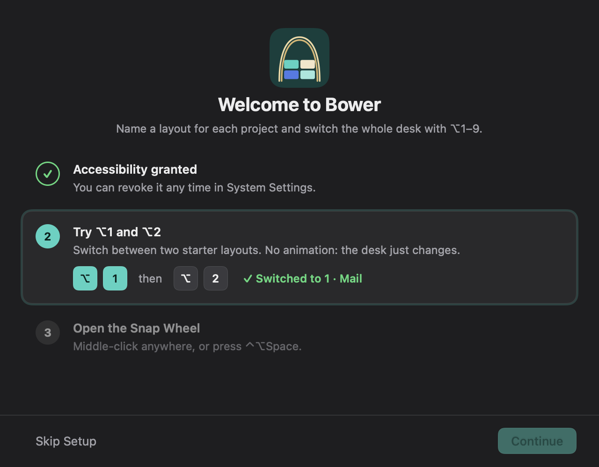 |
| 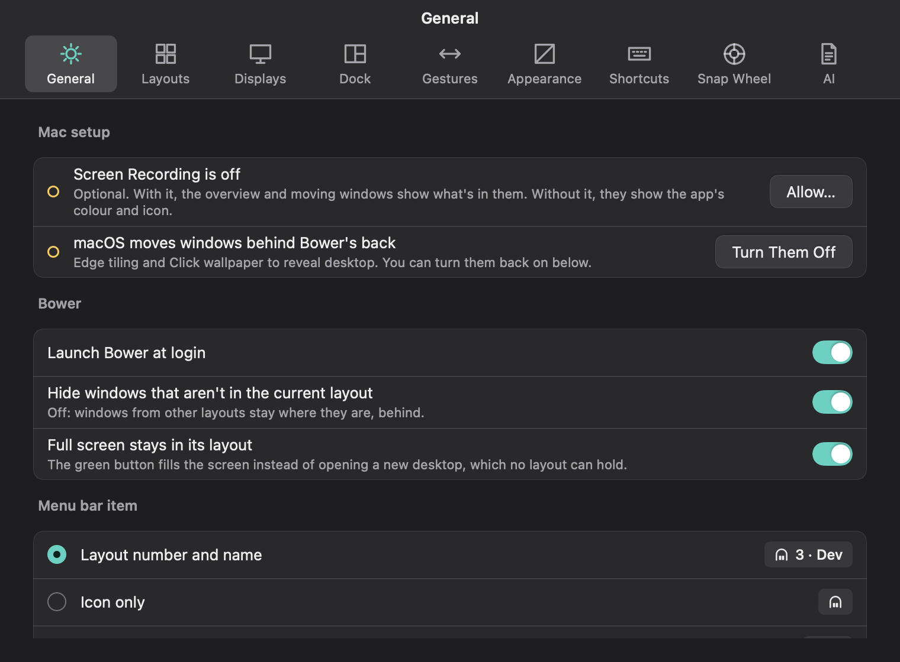 | 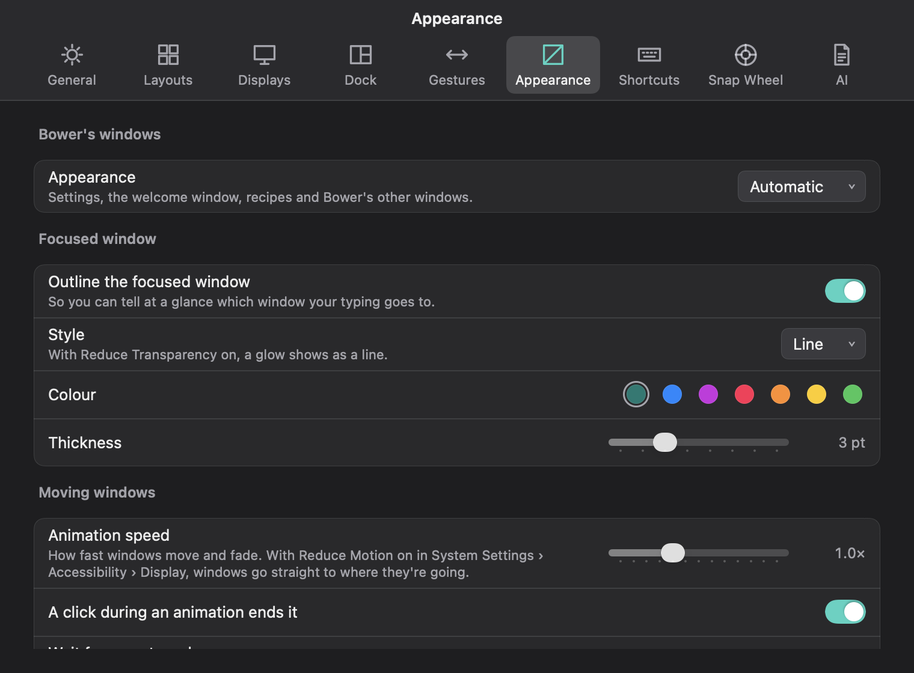 |
| 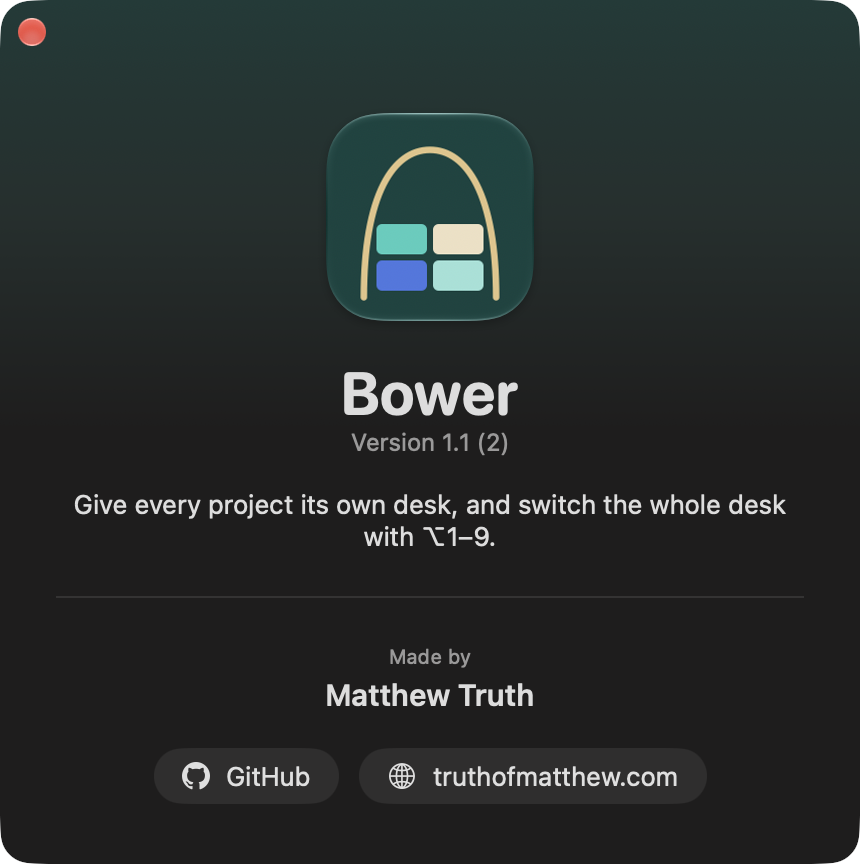 | |

## Shortcuts

| Key | Action |
| --- | --- |
| ⌥1 – ⌥9 | Switch layout |
| ⇧⌥1 – ⇧⌥9 | Send the focused window to a layout |
| ⌥Tab | Next layout |
| ⌥N | Next empty layout |
| ⌃⌥← → ↑ ↓ | Halves |
| ⌃⌥U I J K | Quarters |
| ⌃⌥D F G | Thirds (ISO keyboards: ⌃⌥D < G) |
| ⌃⌥E / ⌃⌥T | First / last two thirds |
| ⌃⌥↩ | Maximize |
| ⌃⌥R | Retile the display (Bento Box) |
| ⌃⌥⌘← → ↑ ↓ (or H J K L) | Focus the window to the left / right / above / below, then the next display |
| ⌃⌥⇧← → ↑ ↓ (or H J K L) | Swap the window with its neighbour that way |
| ⌃⌥W / ⌃⌥⇧W | Wider / narrower: ½, ⅔, 90%, full |
| ⌃⌥C | Centre the window |
| ⌃⌥B | Put windows back in their places |
| ⌃⌥M | Send the window to the next display |
| ⌃Tab | Next tab in the focused group (Tabs Mode) |
| ⌃⌥Space, middle-click, or a three-finger tap | Snap Wheel |
| ⌥↑ | Layouts Bar |
| ⌃⌥S | Save the current workspace |
| ⌃⌥O | Overview: every window on every display |
| ⌃⌥= / ⌃⌥- | Expand a level / back a level |
| ⌃⌥Z | Show the focused window on its own |
| ⌃⌥[ / ⌃⌥] | Go back / forward |
| ⌃⌥1 – ⌃⌥9, ⌃⌥⇧1 – ⌃⌥⇧9 | Go to / save a view |
| ⌃⌥H | Show or hide the Desktop tile (Dock mode) |
| ⌃⌥A | Arrange every window into tiles (Dock mode) |
| ⌃⌥N | Split with a new Finder window (Dock mode) |
| ⌃⌥L | Float or dock the focused window (Dock mode) |

Every shortcut can be changed or cleared in Settings › Shortcuts. A snap shortcut shows where the window will land while you hold it, and moves the window when you let go.

**Snap Wheel:** hold the middle button, move onto an action and release. Or click (or three-finger tap) once to keep it open and click an action. From the keyboard: an arrow picks a wedge, arrows step around the ring, Tab switches rings, → opens a ▸ arc, Return runs, Esc closes. The three-finger tap is off when macOS already uses it for Look Up; it reads the trackpad through a private macOS framework.

## AI Recipes

A Recipe is a Markdown file that describes your desk:

```md
## Projects & Layouts
- Dev — @Code + @Terminal on @main monitor
- Comms — @Slack on @side monitor

## Window modes
- @side monitor uses Bento Box
```

Type `@` for running apps and displays. **Preview** asks a model for a plan and draws it per display; **Apply** names the layouts, moves each app's windows into them and routes the apps so new windows follow. Nothing moves until you press Apply.

Pick a provider in Settings › AI:

- **Ollama** or **LM Studio** on your Mac. Nothing leaves it.
- **Claude** or **OpenAI** with your own API key ("Get a key" links to each console). Bower picks a sensible model; change it from the list.
- **Other**: any OpenAI-compatible endpoint, such as OpenRouter or llama.cpp.

Each provider's key is stored separately in your login Keychain, never in Bower's settings file. A recipe is sent only to the provider you picked, and only when you press Preview. Recipes live in `~/Library/Application Support/Bower/Recipes/`.

## How hiding works

Bower can't use real Spaces with SIP on. Windows from other layouts are parked just off the bottom-right corner of a display instead (a few points may stay visible there). When Bower quits, every parked window comes back.

Bower works on the Space you're in. macOS only shows it that Space's windows, so switch layouts from your desktop, not from a full-screen app's Space.

## Languages

English, Persian, Japanese, German, French, Spanish, Brazilian Portuguese, Italian and Simplified Chinese, following your Mac's language. Persian is laid out right to left; key combinations stay left to right. Translations live in `Sources/Localizable.xcstrings`; `docs/import-translations.py` checks and merges new ones.

## Known limits

- AI Recipes are tested against stand-in endpoints for both request shapes (OpenAI-compatible and Claude's), not yet against every real model. How well a plan comes back depends on the model you pick.
- Expand moves in steps (a level, one window, a rectangle), not as a smooth, continuous change.
- Translations beyond English and Persian were made with AI and haven't been read by native speakers yet.

## Your data

Everything is in `~/Library/Application Support/Bower/state.json`: layout names, which window is in which layout, routes, pinned displays and Window Modes. It's plain JSON, and everything in it can also be changed in Settings.

## Install

You need Xcode 16 or later and [XcodeGen](https://github.com/yonaskolb/XcodeGen) (`brew install xcodegen`).

1. Clone the repo.
2. In `project.yml`, set `DEVELOPMENT_TEAM` to your own Apple team ID and `PRODUCT_BUNDLE_IDENTIFIER` to your own bundle ID.
3. Run `./install.sh`. It builds a Release copy, puts it in `/Applications` and launches it.

On first launch macOS asks you to allow Bower under System Settings → Privacy & Security → Accessibility. Bower checks once a second and starts working as soon as you do.

## License

MIT. See [LICENSE](LICENSE).
